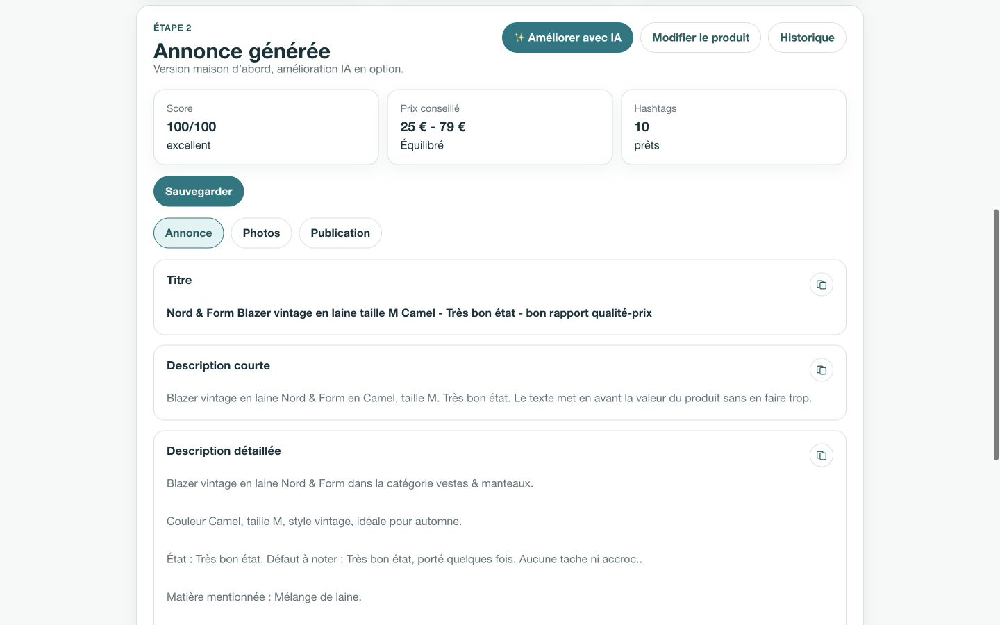
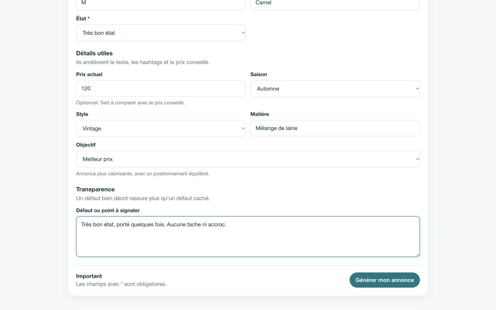
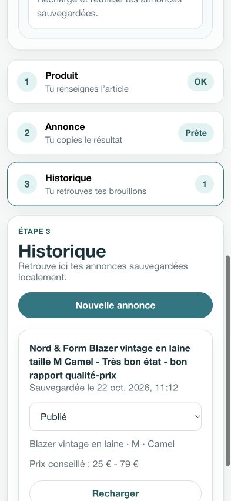
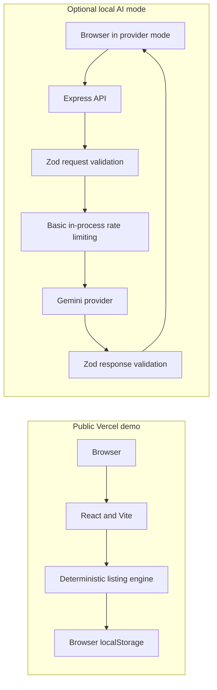

# Vintedito

[](https://github.com/aicha-btn/Vinted-Listing-Assistant/actions/workflows/ci.yml)

Vintedito is an assistant for creating and improving structured second-hand marketplace listings from product details.

**Live demo:** [vintedito.vercel.app](https://vintedito.vercel.app)

The public Vercel demo runs entirely in local simulation mode. The optional Gemini integration uses a separate local Express server; it is not exposed by the public demo.

## Product overview

Vintedito turns a short product form into a ready-to-edit listing with an optimized title, short and detailed descriptions, normalized hashtags, a heuristic price range, and practical publication guidance. Results can be saved locally, assigned a draft, published, or sold status, and reopened from the browser history.

The deterministic listing engine remains the primary path. An optional provider mode can send an already generated listing to Gemini through the server-side API and present the local and improved versions side by side.

## Key features

- Product form with required-field validation and transparent defect reporting
- Deterministic local generation for titles, descriptions, hashtags, and price estimates
- Quality score plus photo and publication checklists
- Accent-normalized hashtags with deduplication and bounded output
- Browser-local history using `localStorage`, including listing statuses
- Local-versus-improved listing comparison
- Optional Gemini improvement through a validated Express API
- Responsive interface for desktop and mobile use

## Screenshots

All screenshots use fictional demonstration data.

### Generated listing



*Generated listing with price guidance, quality score and publishing recommendations.*

### Product form



*Structured product input used by the local listing engine.*

### Mobile history

<p align="center">
  
</p>

<p align="center"><em>Responsive local history with listing status tracking.</em></p>

## Tech stack

- **Frontend:** React 19.2.5, TypeScript 6.0.3, Vite 8.3.5, native CSS
- **API:** Express 5.2.1, Zod 4.6.7, Google GenAI 1.50.1
- **Storage:** browser `localStorage`
- **Testing:** Vitest 5.0.5 and Supertest 7.3.1
- **Quality:** ESLint 10.2.1 and TypeScript project builds
- **Delivery:** GitHub Actions and Vercel

## Architecture



The public Vercel deployment contains the frontend simulation path only; it does not deploy the optional Express/Gemini server.

## Quality and testing

The repository includes **50 deterministic automated tests** covering:

- listing generation, price estimation, hashtags, scoring, and form validation;
- browser storage behavior, including missing and corrupted data;
- Zod request and provider-response schemas;
- Gemini adapter behavior through mocks, with no real provider calls;
- Express HTTP behavior for validation, body limits, unavailable configuration, provider failures, timeouts, and rate limiting.

GitHub Actions runs on every push and pull request targeting `main`. The pipeline performs `npm ci`, tests, linting, type checking, a production build, and an audit gate for critical vulnerabilities. No Gemini key or custom GitHub secret is required for these checks.

## Security and resilience

Security controls include strict runtime validation with Zod, a 32 KB JSON body limit, basic in-process IP rate limiting for the optional AI endpoint, a provider timeout, bounded Gemini output, validated provider responses, and generic public error messages. The Gemini API key remains server-side and is never required by the frontend bundle.

The rate limiter is intentionally process-local and is not presented as a distributed abuse-prevention system.

## Getting started

Use Node.js **22.12 or later**.

```bash
git clone https://github.com/aicha-btn/Vinted-Listing-Assistant.git
cd Vinted-Listing-Assistant
npm install
```

Run the frontend alone in the default local simulation mode:

```bash
npm run dev:client
```

Run the frontend and optional Express server together:

```bash
cp .env.example .env
npm run dev
```

The server can also run independently with `npm run dev:server`. A real Gemini request is possible only when provider mode and a valid server-side API key are configured.

Quality commands:

```bash
npm test
npm run lint
npx tsc --noEmit
npm run build
```

## Environment variables

See [`.env.example`](.env.example) for safe placeholders.

| Variable | Scope | Purpose |
| --- | --- | --- |
| `VITE_AI_MODE` | Client | `simulation` by default; use `provider` for the optional API path |
| `VITE_AI_PROVIDER` | Client | Selects `simulation` or `gemini` |
| `VITE_AI_BACKEND_URL` | Client | Optional API base URL; empty uses the local Vite proxy |
| `GEMINI_API_KEY` | Server | Primary Gemini credential |
| `GOOGLE_API_KEY` | Server | Supported fallback credential |
| `GEMINI_MODEL` | Server | Optional model override; defaults to `gemini-2.5-flash` |
| `PORT` | Server | Optional Express port; defaults to `8787` |

Only variables prefixed with `VITE_` are exposed to the client. Never place a provider key in a `VITE_` variable.

## Limitations

- The public demo uses deterministic simulation rather than live Gemini.
- Price estimates are rule-based heuristics, not live marketplace data.
- Listing history is stored only in the current browser.
- The application does not upload or analyze images.

## Deployment

The frontend demo is deployed on Vercel at [vintedito.vercel.app](https://vintedito.vercel.app). The optional Express backend requires a separate server environment and is not part of that deployment.

## License

No explicit open-source license is currently provided.

Vintedito is an independent project and is not affiliated with or endorsed by Vinted.
